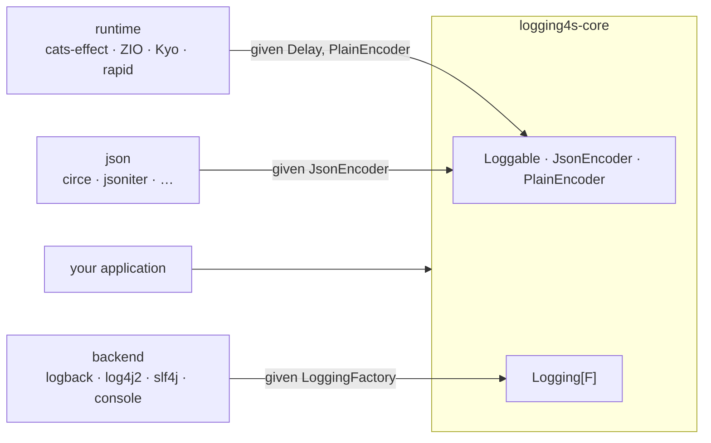

<p align="center">
  <picture>
    <source media="(prefers-color-scheme: dark)" srcset="logos/logging4s-dark.svg">
    
  </picture>
</p>

# logging4s

Structured logging for Scala 3. You describe how your types render with a `Loggable[A]` type class, get a
`Logging[F[_]]` for your effect type, and log values directly. Each value is rendered to JSON and attached to the log
event as structured data; the message string carries a human-readable rendering of the same values.

[](https://github.com/sendline-now/logging4s/actions/workflows/ci.yml)
[](https://central.sonatype.com/search?q=logging4s)
[](https://www.scala-lang.org/)
[](https://www.apache.org/licenses/LICENSE-2.0)

The library is a backend-agnostic `core` plus thin integration modules. The logging backend (logback / log4j2 / slf4j /
console), the effect type (`cats-effect` / ZIO / Kyo / rapid), and the JSON codec (circe / jsoniter / …) are
independent modules, each wired in through a `given` import. `core` has no dependency on any of them.



* [Quick start](#quick-start)
* [The `Loggable` type class](#the-loggable-type-class)
* [Logging](#logging)
* [Backends](#backends)
* [Configuration](#configuration)
* [Modules](#modules)
* [Benchmarks](#benchmarks)
* [Migration](#migration)
* [Adopters](#adopters)
* [Design notes](#design-notes)
* [Contributing](#contributing)

## Quick start

Pick a backend and an effect runtime (a JSON library is optional — `derives Loggable` needs none):

```scala
libraryDependencies ++= Seq(
  "now.sendline" %% "logging4s-cats"    % "7.0.0",
  "now.sendline" %% "logging4s-logback" % "7.0.0"
)
```

```scala
import cats.effect.{IO, IOApp}

import logging4s.core.{Loggable, Logging}
import logging4s.cats.CatsInstances.given        // Delay[IO], cats.Show/data bridges
import logging4s.logback.LogbackInstances.given  // the LoggingFactory

final case class User(id: Int, name: String) derives Loggable

object Main extends IOApp.Simple:
  def run: IO[Unit] =
    for
      log <- Logging.create[IO]("Main")
      _   <- log.info("user created", User(1, "John"))
    yield ()
```

The `logback` backend attaches `User` as a nested JSON object; the message string gets its plain rendering
(abridged — `LogstashEncoder` also writes `@timestamp`, `logger_name`, `thread_name` and the rest of its envelope):

```json
{"message":"user created: user -> (id -> (1), name -> (John))","user":{"id":1,"name":"John"},"source":"Main.scala:13","level":"INFO"}
```

## The `Loggable` type class

Everything centers on one type class. A `Loggable[A]` is required for any value you log:

```scala
trait Loggable[A]:
  def key: ValueKey            // the field name the value logs under
  def json(a: A): JsonString   // structured form
  def plain(a: A): PlainString // human-readable form, appended to the message
```

`ValueKey`, `JsonString` and `PlainString` are opaque `String`s. There are four ways to obtain an instance — `derived`,
`fromEncoders`, `make`, and the field-policy builder `deriving`. Each infers the top-level key from the type name by
default, or takes an explicit key as its first argument — consistently across all four:

```scala
Loggable.derived[User]        // key "user"        Loggable.derived[User]("account")
Loggable.fromEncoders[User]   // key "user"        Loggable.fromEncoders[User]("account")
Loggable.make[User](…)        // key "user"        Loggable.make[User]("account")(…)
Loggable.deriving[User]       // key "user"        Loggable.deriving[User]("account")
```

### Derivation

`derives Loggable` (or `Loggable.derived`) builds both renderings structurally from the fields — each field type needs
its own `Loggable`, and the JSON object is assembled by the macro (no JSON library involved):

```scala
final case class Point(x: Int, y: Int) derives Loggable

enum Color derives Loggable:
  case Red, Green, Blue
```

Products render as objects keyed by field name (run through `keyNameStyle`), and a case class without fields as `{}`.
Sum types delegate to the selected variant, and a `case object` or parameterless enum case renders as its name. Set
`sumTypeDiscriminator = Some("type")` in the [configuration](#configuration) to have every variant lead with its
name — `{"type":"Card","last4":"4242"}`, and `{"type":"Pending"}` for a case without fields, so the field keeps one
JSON type in an index mapping — and a log query can tell `Card` from `Cash`. A variant that already has a field of
that name gets the first free suffix (`type_2`) for the tag instead, and a nested hierarchy is tagged once, with the
leaf's name.

A generic case class derives from its type arguments' instances: `case class Box[A](value: A) derives Loggable` gives
a `Loggable[Box[A]]` for every `A` that has one. Derivation reads the first parameter list only — a case class with a
second one has no `Mirror` and does not derive — and renders every field in it, `private val`s included, just as
`toString` does; hide one with the [per-field builder](#per-field-policies).

### Named tuples

A named tuple needs no declaration at all — it renders as an object keyed by its own field names, which makes it the
lightest way to attach a few related fields to one record:

```scala
log.info("order priced", (currency = "EUR", cents = 1999).asLogValue("price"))
// "price":{"currency":"EUR","cents":1999}
```

They go through the same `keyNameStyle` as a derived product, nest inside one another, and have no arity limit —
unlike plain tuples, whose instances stop at `Tuple5`.

### From an existing codec

If you already have a JSON codec for `A`, `Loggable.fromEncoders` delegates `json` to it. The log JSON is then exactly
your codec's output — its field names, its escaping, untouched by our config. `plain` comes from a `PlainEncoder[A]`
(e.g. bridged from `cats.Show`) when one is in scope. Without one it is derived structurally if every field has a
`Loggable` of its own, and otherwise it is the codec's JSON — so the codec alone is always enough, and a field type
without a `Loggable` never stops `fromEncoders` from compiling:

```scala
import io.circe.Encoder
import io.circe.generic.semiauto.deriveEncoder
import logging4s.core.Loggable
import logging4s.json.circe.CirceInstances.given

final case class User(id: Int, name: String)
object User:
  given Encoder[User]  = deriveEncoder
  given Loggable[User] = Loggable.fromEncoders
```

Prefer this over `derives` when a codec exists: it delegates to the codec's writer instead of assembling strings, and
keeps the logged representation identical to the rest of your app. `derives` is for types that have no codec.

### By hand

Give the two renderings directly — `json` returns a `JsonString` (use `JsonString.quoted` to escape a string value, or
`JsonString(...)` for a raw JSON fragment), `plain` returns a `PlainString`:

```scala
import logging4s.core.{Loggable, JsonString, PlainString}

given Loggable[Money] =
  Loggable.make(m => JsonString(m.cents.toString), m => PlainString(s"$$${m.cents / 100.0}"))
```

### Adapting an existing instance

Derive a `Loggable` for a wrapper type from the underlying type's instance with `contramap` (optionally renaming the
key), or `redacted` to mask a type everywhere it is logged:

```scala
final case class UserId(value: Int)
given Loggable[UserId] = Loggable[Int].contramap(_.value, "user_id")

final case class Password(value: String)
given Loggable[Password] = Loggable[String].contramap(_.value, "password").redacted()  // always renders "***"
```

`redacted` masks the whole type wherever it appears; to mask a single field of a product, use `.mask` in the
[per-field builder](#per-field-policies).

### Per-field policies

For derived products, override individual fields with a builder. Selectors are macro-checked field references — not
strings, not annotations — so they survive refactors and work on types you don't own. A nested path
(`_.address.city`), a method call or a member that is not a constructor field is a compile error, so a policy can
never silently apply to nothing:

```scala
import logging4s.core.Loggable
import logging4s.core.deriving.MaskMode

final case class Account(id: Int, email: String, password: String, address: Address)
object Account:
  given Loggable[Account] =
    Loggable.deriving[Account]
      .hide(_.password)                    // omit
      .mask(_.email)(MaskMode.KeepLast(4)) // partial mask
      .rename(_.id, "account_id")          // custom key
      .unembed(_.address)                  // splice its fields into the parent object
      .derived
```

`unembed` flattens the JSON only; the plain rendering keeps the field nested.

`MaskMode.Full` replaces every character, so it still reveals the length; for secrets prefer
`MaskMode.Fixed("***")`, which renders the same mask whatever the value. `KeepLast(n)` / `KeepFirst(n)` show part of
the value, for card numbers and the like.

## Logging

`Logging.create` returns `F[Logging[F]]`; the log methods return `F[Unit]`. There are `createTry` / `createEither` /
`createUnsafe` variants for non-effect code.

```scala
for
  log <- Logging.create[IO]("OrderService")
  _   <- log.info("service started")
  _   <- log.info("order placed", user, order)          // any number of values
  _   <- log.error("payment failed", throwable, order)  // with a cause
  scoped = log.withContextValues(requestId.asLogValue("request_id"))
  _   <- scoped.info("handled")                         // context attached to every line
yield ()
```

The passed message is joined with the `plain` rendering of the values, and each value is attached as structured data
for the backend to emit as fields. Any value whose type has a `Loggable` can be passed as it is — `user`,
`List(1, 2)`, `Some(order)` — and converts under the key of its `Loggable`, with no
`import scala.language.implicitConversions` (`LoggableValue` is declared an `into` target); `asLogValue("key")` picks
the key yourself.

Every record also carries the call site as a `source` field: the file name and line, `OrderService.scala:42`, without
the directory or package — two files of the same name in different packages read the same.

The call site is captured at **compile time** — `Position` is an implicit parameter filled in by an inline given, so
it costs a constant in the emitted code rather than the stack-trace walk that `%F:%L` and log4j2's location info do at
log time. One consequence worth knowing: it is the position of the *log call*, so if you wrap logging in a helper,
every record points at the helper. Take `Position` as a parameter and it follows your caller instead:

```scala
def audit(action: String)(using Logging[IO], Position): IO[Unit] =   // without `using Position`,
  Logging[IO].info(action)                                          // source points here, not at the caller
```

Duplicate keys resolve by specificity: a call-site value overrides a context value with the same key, and a later
`withContext` overrides an earlier one. Only duplicates *within a single call* are suffixed (`k`, `k_2`), since those
are two values you deliberately passed.

An interpolator is available for terser call sites — import the log syntax and have a `given Logging[F]` in scope:

```scala
import logging4s.core.syntax.logging.*

info"order placed: $order"   // == log.info("order placed", order.asLogValue("order"))
```

The key comes from what you interpolate:

| Hole | Key |
| --- | --- |
| an identifier, `$order` | `order` |
| a selection rooted in one, `${user.id}`, `${items.size}` | the path joined, `user_id`, `items_size` |
| a service selector, `${maybe.get}`, `${xs.head}`, `${pair._1}` | the value's `Loggable` key, as for any other expression |
| any other expression, `${compute()}`, `${Point(1, 2).x}` | the value's `Loggable` key |

Values render lazily, and every log call checks the level before it builds anything — a `debug` under a logger set to
`INFO` evaluates neither its values (nor an interpolator's expressions) nor their JSON, and allocates no effect. The
check happens when the `F[Unit]` is *constructed*, so a log action built once under a disabled level and run later
stays suppressed; build and run it in the same place (the usual `for` comprehension) and this never comes up.

A hole whose static type is a `Throwable` becomes the record's **cause** rather than a value, so the backend gets
the exception and keeps its stack trace — `error"payment failed $e"` is `log.error("payment failed", e)`. With
several, the last one is the cause and the earlier ones stay values.

When the level is only known at runtime, `log(level, …)` takes it as the first argument, with the same four shapes
as the per-level methods and the same static-message check:

```scala
log.log(if attempt > 3 then Level.Warn else Level.Debug, "retrying", attempt.asLogValue("attempt"))
```

Value-building helpers (`asLogValue`, `mapPlain`, `withKey`) are in `logging4s.core.syntax.loggable.*`;
`logging4s.core.syntax.all.*` brings both. `asLogValue(key)` renders through the type's `Loggable`; `withKey(key)` is
for a type that has codecs but no `Loggable` — it builds one from the `JsonEncoder` and `PlainEncoder` on each call, so
for a type you log often, `given Loggable[A] = Loggable.fromEncoders` and `asLogValue` is the better pair.

A `Loggable` that throws never costs you the record. The value renders as
`[failed to render: java.lang.IllegalStateException: …]` in both forms, the rest of the record is written, and the
logging effect succeeds — the contract SLF4J and log4j2 keep for a parameter whose `toString` throws.

Control characters inside values — newlines, carriage returns, terminal escape sequences, the Unicode line
separators — are escaped when values are rendered into the message text (`\n`, `\r`, `\u001b`), and so is the
cause's message, which often carries user input. A value can therefore never forge a second line in a plain-text log.
The structured JSON channel was already safe; your own static message text is left as written.

### Fiber-local context

`withContext` attaches values to one logger. To attach them to everything logged *while an effect runs* — a request
id set by a middleware, say — without threading a logger through every call, wrap the logger with
`Logging.contextual` and scope the effect. The context lives in the runtime's own fiber-local storage, so it follows
the effect across threads and into the fibers it forks:

```scala
import logging4s.zio.ZioInstances.given

val log = Logging.contextual(base)                              // reads the ambient context on every record

ZioLoggingContext.scoped(requestId.asLogValue("request_id")) {  // any ZIO[R, E, A]
  handle(request)                                                // every record inside carries request_id
}
```

| Runtime | Storage | `LocalContext` for | Scope an effect with |
| --- | --- | --- | --- |
| cats-effect | `IOLocal` | `IO`: `IOLocalContext.make`; any `F` with `LiftIO` and `MonadCancelThrow`, such as `Kleisli[IO, R, *]`: `IOLocalContext.lifted[F]`, or `lift[F](local)` over an `IOLocal` you share | `local.scoped(values*)(fa)` |
| ZIO | one global `FiberRef` | any `ZIO[R, E, *]`, as a `given` | `ZioLoggingContext.scoped(values*)(zio)` |
| Kyo | one global `Local` | any `A < S`, as a `given` | `KyoLoggingContext.scoped(values*)(v)` |

A call-site value still wins over the ambient context, and the ambient context wins over the logger's own
`withContext`, since it is scoped closer to the call. Nested scopes add to each other — an inner scope that sets a key
again overrides it until it ends — and the previous context comes back when a scope ends, however it ends: failure,
cancellation and interruption included. A disabled level does not read the fiber-local at all. For any other effect,
`LocalContext[F]` is two methods — `use` and `scoped` — to implement over whatever fiber-local your runtime has.

### Testing

`Logging.noop[F]` discards everything. `logging4s.core.testing.RecordingLogging[F]` captures each record the way a
backend would emit it — context merged, keys normalized and deduplicated — so a test can assert on it without a logging
framework:

```scala
val log = RecordingLogging[Try]()
service(log)

log.recorded.map(_.message) shouldEqual Seq("user created")
log.recorded.head.plainOf("user_name") shouldEqual Some("John")
log.recorded.head.jsonOf("user_name") shouldEqual Some("\"John\"")   // valueOf is this JSON form too
```

## Backends

`Loggable.json` produces a `JsonString`, but how that reaches the log output depends on the backend — this is the one
choice that materially affects the result:

| Backend | How structured values are emitted | Nested JSON? |
| --- | --- | --- |
| `logback` | one logstash marker per record that writes each value as raw JSON | **Yes** — objects/arrays come out as genuine nested JSON |
| `log4j2` | a `MapMessage` argument on the log call (no MDC) | **Yes** with `JsonTemplateLayout` in object mode — our `MapMessage` renders its values as raw JSON |
| `slf4j` | slf4j 2.x fluent `addKeyValue` | Depends on the provider you bind; typically strings |
| `console` | writes the JSON line itself | **Yes** — no logging framework underneath |

The same `log.info("user created", User(1, "John"))` (with `User derives Loggable`) comes out as:

```jsonc
// logback (LogstashEncoder) — user is a nested object alongside the message
{"message":"user created: user -> (id -> (1), name -> (John))","user":{"id":1,"name":"John"}}

// slf4j — the same value, escaped, because its key-value pairs are stringly-typed
{"message":"user created: user -> (id -> (1), name -> (John))","user":"{\"id\":1,\"name\":\"John\"}"}
```

`log4j2` also emits `user` as a genuine nested object, but its `JsonTemplateLayout` reaches the text and the values
through the *same* resolver, so a template has to ask for both explicitly — see
[the log4j2 template](#log4j2-json-template) below. The difference between backends is whether `user` is a queryable
object or an opaque string. All of them share the same `Logging.create` API — you only swap the
`import logging4s.<backend>.<Backend>Instances.given`.

<a id="log4j2-json-template"></a>

For `log4j2`, use an event template that renders the message twice — once stringified for humans, once in object mode
for the structured values:

```json
{
  "message": {"$resolver": "message", "stringified": true},
  "data": {"$resolver": "message"}
}
```

A template with only `{"$resolver": "message"}` emits the values and **drops the human-readable text**; that is the
resolver's object mode, not a logging4s limitation. This exact template is pinned by a test against a real
`JsonTemplateLayout`.

<details>
<summary>How structured values reach each backend</summary>

`Loggable.json` produces a **pre-rendered JSON string**. To appear as a real nested object it must be spliced into the
output *raw* (not re-escaped as a string), which each backend handles differently:

* **logback** attaches one logstash marker per record. `LogstashEncoder` asks it to write its fields, and it splices
  each value's JSON in raw. The JSON is rendered only then, so an appender that prints text alone (a `PatternLayout`)
  never pays for it, and however many encoders write the record, it is rendered once. `%marker` in a pattern shows
  the values as `key=json` pairs.
* **log4j2** puts them into a `MapMessage`. `MapMessage` is a `MultiformatMessage`, and we render its JSON form with
  raw values, so a `JsonTemplateLayout` `message` resolver in object mode (its default, `stringified: false`) splices
  them as real nested JSON — no custom resolver needed.
* **slf4j** hands them to `addKeyValue`; slf4j is only a facade, so rendering is up to whichever provider you bind, and
  its `KeyValuePair`s have no raw-JSON notion — expect escaped strings. A value named after an envelope field
  (`level`, `message`, …) is suffixed (`level_2`), as on every other backend.
* **console** builds the whole line itself, so there is nothing to splice.

We never touch your `logback.xml` / `log4j2.xml`: values are only *attached* to the event and your encoder/layout
decides what to render. The nested-JSON guarantees assume a JSON layout (`LogstashEncoder` / `JsonTemplateLayout`) — a
plain `PatternLayout` prints the text message and ignores the structured attachment.

</details>

`logging4s-logback` also ships an opt-in `Logging4sEncoder` that writes the JSON itself — no `LogstashEncoder`
round-trip, no Jackson — smaller and faster for the fixed shape it emits (`@timestamp`, `level`, `logger`, `thread`,
`message`, your values as raw nested JSON, MDC, slf4j 2.x fluent key-value pairs, `stack_trace`). Point your appender
at it in `logback.xml`:

```xml
<encoder class="logging4s.logback.Logging4sEncoder"/>
```

It reads logging4s values, the MDC and the event's own key-value pairs, so plain
`logger.atInfo().addKeyValue("request_id", id).log("event")` from elsewhere in your application keeps its structured
field. A line never carries a key twice: an MDC or key-value entry with the same key as a logging4s value is dropped,
since the value is the more specific of the two, and one named after an envelope field (`level`, `message`, …) gets
the first free suffix (`level_2`) rather than shadowing it. An MDC entry or key-value pair without a value is written
as `null`; any other key-value pair is written as its `toString`, quoted. It does **not** understand third-party
logstash markers — if a dependency attaches those, stay on `LogstashEncoder`.

The envelope is configurable from the same XML — rename any field with `timestampField`, `levelField`, `loggerField`,
`threadField`, `messageField` or `stackTraceField`, and leave parts out with `includeThread`, `includeMdc` or
`includeKeyValuePairs` (all `true` by default). A logging4s value that takes a renamed field's name is suffixed, as
with the default names:

```xml
<encoder class="logging4s.logback.Logging4sEncoder">
  <timestampField>time</timestampField>
  <messageField>msg</messageField>
  <includeThread>false</includeThread>
</encoder>
```

If you'd rather keep `LogstashEncoder` (or any other), nothing changes — the structured values are attached both ways.

### Standalone console

`logging4s-console` needs no logging framework at all — it writes structured JSON (or colored plain text) straight to
stdout/stderr, which fits containers and 12-factor apps. It's configured via HOCON under `logging4s.console` — override
it in your `application.conf`, or with `LOGGING4S_CONSOLE_*` environment variables:

```hocon
logging4s.console {
  level  = "info"    # off | error | warn | info | debug | trace
  format = "json"    # json | plain
  color  = "auto"    # auto (terminal only) | on | off   — plain format
  stream = "stdout"  # stdout | stderr
  max-stack-trace-lines = -1   # -1 keeps the full trace

  # per-logger thresholds: exact name or dot-segment prefix, most specific wins
  levels {
    "io.netty"       = "warn"
    "io.grpc"        = "off"     # silenced entirely
    com.acme.Service = "debug"
  }
}
```

`auto` colors only when stdout is an interactive terminal. On JDK 22 and later `System.console()` also exists when the
output is redirected, so `auto` additionally asks the console whether it is a terminal — piped and container logs
stay free of ANSI codes. The question is about the process's terminal rather than the configured stream, so with
`stream = "stderr"` redirected to a file while stdout stays on a terminal, set `color = "off"`.

A logger's threshold is resolved once, from the `ConsoleConfig` in scope when the logger is created, and the default
configuration is read once per process — there is no runtime reload. To change levels while running, create loggers
under a new `given ConsoleConfig`. A value the backend does not recognise — `level = "warning"`, say — is not ignored:
creating the first console logger throws an `IllegalArgumentException` naming it, so a typo surfaces at startup.

`off` silences a logger completely, at the root or per logger. It is a *threshold*, not a level — `Level` still has
exactly the five levels you can log at, and the console config holds a `Threshold` (`Threshold.Off` or
`Threshold.At(level)`) so that no backend has to answer the meaningless question of what it means to *write* a record
at level "off". The other backends need nothing here: their `enabled` delegates to logback / log4j2 / your slf4j
provider, each of which already has `OFF` in its own configuration.

```scala
import logging4s.console.ConsoleInstances.given

val log = Logging.create[IO]("Main")   // structured JSON to stdout, no logback.xml
```

## Configuration

Rendering is controlled by a single `LoggableEncodingConfig` (`logging4s.core.config`). A default `given` is provided;
override it once, application-wide:

```scala
import logging4s.core.config.*

given LoggableEncodingConfig =
  LoggableEncodingConfig(
    keyNameStyle     = KeyNameStyle.CamelCase,
    plainValuesStyle = PlainValuesStyle.Logfmt
  )
```

| Field | Default | Effect |
| --- | --- | --- |
| `jsonTupleAsArray` | `true` | tuple/`Ior` JSON: `true` → `[1,"a"]`, `false` → `{"int":1,"string":"a"}` |
| `mapAsObject` | `true` | `Map` JSON: `true` → `{"a":1}`, `false` → `[["a",1]]` (the 3.x shape) |
| `keyNameStyle` | `SnakeCase` | applied to every key: `AsIs` / `SnakeCase` / `KebabCase` / `CamelCase` / `PascalCase` |
| `plainTupleStyle` | `AsScala` | tuple plain form: `(1, a)` / `[1, a]` / `1, a` / `{1, a}` |
| `plainValuesStyle` | `Arrow` | value-list join: `Arrow` `k -> (v)`, `Logfmt` `k=v`, `Colon` `k: v`, `CurlyMap` `{k=v}`, … |
| `includeSourcePosition` | `true` | attach the call site as a `source` field (`"OrderService.scala:42"`, the file name only) |
| `includeValuesInMessage` | `true` | append the values to the message text; `false` keeps the message as bare static text and renders only the structured form — each value is then rendered once rather than twice, the sensible setting for a pipeline that reads only the JSON |
| `omitAbsentValues` | `false` | `true` drops an absent value (`None`, `Some(None)`, `Unit`, kyo `Absent`) instead of rendering `null` — both a top-level value and a field of a derived product. Absence is decided without rendering the value |
| `sumTypeDiscriminator` | `None` | `Some("type")` makes a derived sum type's JSON lead with the variant name: `{"type":"Card",…}` |

`keyNameStyle` and `plainValuesStyle` are applied by the backend at aggregation time; `jsonTupleAsArray`,
`plainTupleStyle` and `mapAsObject` are baked into compound `Loggable`s when they are summoned. A single top-level
`given` covers both.

Default keys: scalars key by type name (`Loggable[Int]` → `int`, `UUID` → `uuid`), and a derived case class by its
decapitalized name (`User` → `user`). The standard library types key by what they are:

| Types | Key |
| --- | --- |
| `Instant`, `java.util.Date`, `LocalTime` and the date-time types | `time` |
| `LocalDate` | `date` |
| `Year`, `YearMonth`, `MonthDay`, `Month`, `DayOfWeek`, `Period` | `year`, `year_month`, `month_day`, `month`, `day_of_week`, `period` |
| `ZoneId`, `ZoneOffset` | `zone` |
| `java.time.Duration`, `FiniteDuration`, `Duration` | `time_ms` — an infinite or undefined `Duration` renders `null` |
| `URI`, `URL`, `InetAddress`, `Path`, `Locale`, `Currency` | `uri`, `url`, `ip`, `path`, `locale`, `currency` |
| `Throwable` | `error` — `{"class":…,"message":…}`, with its `cause` chain nested up to five deep |
| `Try[A]` | `error_<key of A>` — the value, or the failure as a `Throwable` |

Collections append a plural suffix (`List[Int]` → `ints`) — a naive English one (`child` → `childs`), so set a key
where it reads badly. Two values of one type share a key, so two timestamps in one call come out as `time` and
`time_2`; give them names. A `Map[K, V]` keys as `<k>_<v>s`, which for `Map[String, String]` is `strings` — the same as
a `List[String]` — and a search index that maps one field to both an object and an array rejects the second, so give a
`Map` its own key.

## Modules

Published for Scala 3 under `now.sendline`:

```scala
"now.sendline" %% "logging4s-<module>" % "7.0.0"
```

| | Module | Min. Scala | Notes |
| --- | --- | --- | --- |
| core | `logging4s-core` | 3.9 LTS | type classes + `Logging`; no backend dependency |
| backend | `logging4s-logback` | 3.9 LTS | slf4j + logback + logstash-encoder; real nested JSON |
| | `logging4s-log4j2` | 3.9 LTS | Log4j2 API; values as a `MapMessage` |
| | `logging4s-slf4j` | 3.9 LTS | bare slf4j-api 2.x `addKeyValue`; bring your own binding |
| | `logging4s-console` | 3.9 LTS | standalone JSON/plain to stdout/stderr; HOCON-configured; no logging framework needed |
| runtime | `logging4s-cats` | 3.9 LTS | `cats-effect 3`; plain via `cats.Show`; context via `IOLocal` |
| | `logging4s-zio` | 3.9 LTS | `zio.Task` and `zio.UIO`; plain via `zio.prelude.Debug`; context via `FiberRef` |
| | `logging4s-kyo` | 3.9 LTS | `kyo.Sync`; plain via `kyo.Render`; context via `kyo.Local` |
| | `logging4s-rapid` | 3.9 LTS | `rapid.Task` |
| json | `logging4s-circe` | 3.9 LTS | `io.circe.Encoder` |
| | `logging4s-jsoniter` | 3.9 LTS | `jsoniter-scala JsonValueCodec` |
| | `logging4s-zio-json` | 3.9 LTS | `zio-json JsonEncoder` |
| | `logging4s-play-json` | 3.9 LTS | `play-json Writes` |
| | `logging4s-spray-json` | 3.9 LTS | `spray-json JsonWriter` |
| | `logging4s-json4s` | 3.9 LTS | `json4s Formats`; encodes any type by reflection, so one it cannot open (a JDK type such as `Instant`) fails when rendered, not when compiled |
| | `logging4s-argonaut` | 3.9 LTS | `argonaut EncodeJson` |
| | `logging4s-borer` | 3.9 LTS | `borer Encoder` |
| | `logging4s-upickle` | 3.9 LTS | `upickle Writer` |
| | `logging4s-weepickle` | 3.9 LTS | `weepickle From` |
| | `logging4s-fabric` | 3.9 LTS | `fabric Json` |

### Compatibility

Every module is built on the `3.9 LTS` release. `Scala 3` TASTy is backward but not forward compatible, so **no release
from 4.0 on can be consumed from a `3.3 LTS` project** — `3.0.x` is the line to stay on until your application moves
to `3.9`.
In exchange, the split that 3.x had is gone: `logging4s-kyo` and `logging4s-rapid` used to be pinned to a newer Scala
than everything else, and now sit on the same release as `core`.

Every artifact is compiled with `-release 17`, so it runs on **JDK 17 or later** and the compiler checks each call
against the JDK 17 API rather than whichever JDK built it. `logging4s-kyo` is the exception, below.

Within a major version, binary compatibility is checked by
[MiMa](https://github.com/lightbend/mima) on every build, and `versionScheme := "semver-spec"` describes what the
artifacts promise.

`7.0.0` moves logging4s to the `now.sendline` organization and changes nothing else: the code is `6.1.0`'s, the package
is still `logging4s`, and MiMa checks every module against `org.logging4s` `6.0.0` and `6.1.0`. Swapping the
organization in `build.sbt` is the whole upgrade — see [From 6.1 to 7.0](#from-61-to-70). `org.logging4s` `7.0.0` is
published as a relocation, so a build that only bumps the version is moved to `now.sendline` by Maven and by sbt. The
repository is [sendline-now/logging4s](https://github.com/sendline-now/logging4s), and the site is
[oss.sendline.now/logging4s](https://oss.sendline.now/logging4s/).

`logging4s-kyo` depends on a kyo release candidate (`1.0.0-RC7`). Until kyo reaches `1.0.0` final, that module sits
outside the binary-compatibility promise the other artifacts make. Compiling it also needs **JDK 25** — kyo's `Frame`
macro runs inside the compiler and its class files target Java 25, so this is a compile-time requirement, not just a
runtime one.

Each integration module exposes its `given`s as a named trait plus a companion object, so you can also mix several into
one import for your app:

```scala
object instances extends LogbackInstances with CatsInstances with CirceInstances
```

## Benchmarks

A JMH harness in [`benchmarks/`](benchmarks) logs the same mid-size event (eight fields — every scalar type, a list, and
one nested object) through each backend, routed to a discarding sink so only CPU cost is measured. Structured values are
built with the same jsoniter codec everywhere, except the two `console` rows, which contrast the two derivation paths.

Every row is logging4s itself, wired to a different backend/encoder — this compares **our own backend choices against
each other**, not logging4s against other logging libraries (there is no third-party baseline here).

```bash
sbt "benchmarks/Jmh/run -f 1 -wi 5 -i 12 .*BackendsBench.*"
```

Measured on 6.1 as **throughput — operations per second, higher is better** — and as the bytes allocated per record
(`-prof gc`), with 6.0 alongside (single fork, one developer machine — rough ballpark, not authoritative; run it on
your own hardware):

| Config | ops/s | bytes per record | on 6.0 |
| --- | ---: | ---: | ---: |
| `log4j2` + `JsonTemplateLayout` (nested) | ~705k | ~4.2 KB | ~7.6 KB |
| `console` + `fromEncoders` (jsoniter) | ~663k | ~4.3 KB | ~8.6 KB |
| `logback` + `Logging4sEncoder` | ~643k | ~5.3 KB | ~10.3 KB |
| `console` + `derives` | ~606k | ~6.0 KB | ~11.0 KB |
| `log4j2` (stringified message) | ~510k | ~3.7 KB | ~6.1 KB |
| `logback` + `LogstashEncoder` | ~494k | ~3.9 KB | ~6.2 KB |

> Throughput on this machine is **rough**: error bars of ±5–7% within a run, and noticeably wider swings between runs.
> Read it as orders of magnitude, not a precise ranking. The bytes per record are stable to the byte between runs, and
> are the better measure of what a change did.

Takeaways:

* Throughput spans roughly ~490k–705k ops/s. `log4j2` with `JsonTemplateLayout` leads; the two configurations that
  hand the JSON to a stock encoder or layout trail.
* 6.1 allocates **38–49% fewer bytes per record** than 6.0 on every configuration: the message text and the JSON line
  are each built in one presized buffer and escaped in place, small value lists are scanned rather than hashed, and
  logback renders a value's JSON only when an encoder writes it.
* The **encoding path matters as much as the backend**: on the same `console` backend, `fromEncoders` with a codec
  allocates ~28% less than `derives`, which assembles both JSON and plain from `Mirror`.
* `Logging4sEncoder` (~643k) runs ~1.3× `LogstashEncoder` (~494k) — it builds the JSON in a single pass, straight from
  the event, with no Jackson round-trip. It allocates more per record, because it builds the line as a `String` and
  then encodes it, where `LogstashEncoder` writes through Jackson's recycled buffers.

### The disabled-level path

A second harness measures what a *suppressed* record costs — a `debug` call under a logger set to `INFO`:

```bash
sbt "benchmarks/Jmh/run -f 1 .*LevelGateBench.*"
```

| Call shape | ops/s on 6.1 | on 6.0 |
| --- | ---: | ---: |
| interpolator, level off (`debug"event $e"`) | ~779M | ~791M |
| direct call with a lazy value, level off | ~793M | ~387M |
| direct call with a pre-rendered value, level off (2.x behaviour) | ~757M | ~1.5M |
| interpolator, level on | ~444k | ~409k |
| direct call, level on | ~476k | ~406k |

In 2.x a suppressed `debug` still rendered every value to JSON at the call site, so it cost roughly a quarter of an
actual log write. 3.0 made values render lazily (~250× cheaper), and the interpolator skipped the call entirely when
the level was off. Since 6.1 every call does — a direct call checks the level before it evaluates its arguments, so
even a value pre-rendered at the call site is never built, and the three suppressed shapes cost the same. With the
level *on*, the guard costs nothing measurable.

> The two disabled rows are JIT-optimistic in absolute terms: with nothing escaping, escape analysis removes the
> wrapper allocations outright, so ~1.3 ns/op is a floor rather than a field measurement. The orders of magnitude and
> the ordering are the signal; the enabled rows are ordinary measured work.

## Migration

### From 6.1 to 7.0

Only the organization changes. The code is `6.1.0`'s, the package is still `logging4s`, and MiMa checks every module of
`7.0.0` against `org.logging4s` `6.0.0` and `6.1.0` and finds nothing.

```diff
- "org.logging4s" %% "logging4s-cats" % "6.1.0"
+ "now.sendline"  %% "logging4s-cats" % "7.0.0"
```

A build tool treats a new organization as a new library, so it will not evict one in favour of the other. If anything
in your graph still brings `org.logging4s` `6.x` — an internal library not yet moved — both jars land on the classpath
with the same classes, and which one loads depends on classpath order. Move that library too, or exclude the old
organization where it comes in:

```scala
libraryDependencies += ("com.example" %% "internal-commons" % "1.2.3").excludeAll(ExclusionRule("org.logging4s"))
```

`org.logging4s` `7.0.0` exists as a relocation: each module is a `pom` whose `<relocation>` names `now.sendline`, with
no jar of its own. Maven, and sbt through Coursier, resolve it to the `now.sendline` module of the same name and
version, so a build — or Scala Steward — that only bumps the version lands on the new organization. The `pom`'s
description and the relocation's message both say where it went, so Maven prints the move as it follows it and Central
shows it on the old coordinates' page; sbt follows it without saying so. Nothing is published under `org.logging4s`
after it.

### From 6.0 to 6.1

6.1 is binary compatible with 6.0 — MiMa checks every module against it — and call sites compile unchanged, with one
deliberate exception (8). What moves is output, where 6.0 rendered a value in the wrong shape, under a key that did not
say what it was, or not at all.

```diff
- "org.logging4s" %% "logging4s-cats" % "6.0.0"
+ "org.logging4s" %% "logging4s-cats" % "6.1.0"
```

**1. `Some(x)` renders as `x`.** Through `asLogValue` or the interpolator, a `Some` came out as a one-element array
under the plural key (`"ints":[1]`); it now renders like the `Option` it is (`"int":1`), as a directly passed one
already did. `List` and `Vector` passed directly now compile, where 6.0 found two ambiguous conversions.

**2. An interpolated selection keys by its path.** `info"… ${user.id}"` logged under `id`; it is now `user_id`, and
`${items.size}` is `items_size`. A service selector (`.get`, `.head`, `._1`) and any other expression keep the
value's `Loggable` key — see the [interpolator](#logging) table.

**3. A case class without fields renders as `{}`**, not as its name; a `case object` keeps its name. Under
`sumTypeDiscriminator`, a variant without fields renders as `{"type":"Pending"}` rather than `"Pending"`, so the field
keeps one JSON type.

**4. A `Throwable` value nests its cause chain** — `{"class":…,"message":…,"cause":{…}}`, five deep and cycle-safe.

**5. The console describes the cause in the message** — `payment failed: class=…, message=boom` — as every other
backend already did.

**6. Direct calls check the level before evaluating their arguments.** `log.debug("x", expensive())` under `INFO` no
longer calls `expensive()`, as the interpolator already behaved — a side effect inside a log argument runs only when
the record is written.

**7. A `Loggable` that throws renders a placeholder.** 6.0 failed the logging effect, or with logback could lose the
line; the value now renders as `[failed to render: …]` and the rest of the record is written.

**8. The builder rejects a selector that is not a constructor field.** `Loggable.deriving[A].hide(_.someDef)` compiled
and hid nothing; it is now a compile error naming the member. It only fires on a policy that never applied.

**9. Smaller output fixes.** Keys of the context given at creation that normalize to one name (`userId`, `user_id`)
collapse, as `withContext` already did; `slf4j` suffixes a value named after an envelope field (`level_2`) like the
other backends; `Unit` counts as absent, so `omitAbsentValues` drops it; and `Logging4sEncoder` writes an MDC entry or
key-value pair without a value as `null` — 6.0 lost the whole line on a `null` MDC value and wrote a `null`
key-value pair as the string `"null"`.

### New in 6.1 (optional — pick these up while you're here)

- **No `implicitConversions` import** at call sites — `LoggableValue` is an `into` target.
- **Fiber-local context for more effects** — `IOLocalContext.lifted[F]` / `lift[F](local)` for any `F` with `LiftIO`
  and `MonadCancelThrow`, and `LocalContext` for every `ZIO[R, E, *]` and kyo `A < S`; see
  [Fiber-local context](#fiber-local-context).
- **More standard instances** — `Year`, `YearMonth`, `MonthDay`, `Month`, `DayOfWeek`, `Period`, `ZoneId`,
  `ZoneOffset`, `java.util.Date`, `Duration`, `URI`, `URL`, `InetAddress`, `Path`, `Locale`, `Currency` and `Try`; see
  the [default keys](#configuration).
- **`fromEncoders` always compiles** with a codec, falling back to the codec's JSON for `plain` when the type cannot be
  derived.
- **`Logging4sEncoder` is configurable** — field names and `includeThread` / `includeMdc` / `includeKeyValuePairs`
  from `logback.xml`.
- **`RecordedEvent.jsonOf` / `plainOf`** read a recorded value in either form; `valueOf` stays the JSON form, so a
  string comes back quoted (`Some("\"svc\"")`).
- **`Logging.emitWith`** for a backend that merges an ambient context into the record itself.
- **38–49% fewer bytes per record** on every backend; see [Benchmarks](#benchmarks).

### From 5.x to 6.0

Call sites compile unchanged. What moves is output in a few places where 5.x lost data or produced lines that could
be forged, plus some test-toolkit and SPI signatures.

```diff
- "org.logging4s" %% "logging4s-cats" % "5.0.0"
+ "org.logging4s" %% "logging4s-cats" % "6.0.0"
```

**1. An interpolated `Throwable` is the cause.** `error"payment failed $e"` used to attach `e` as a field
`{"class":…,"message":…}` and pass no cause, so the stack trace was lost. The exception now reaches the backend as the
cause: the record gains `stack_trace`, the message text gains `class=…, message=…`, and the `e` field is gone. To keep
an exception as a plain value, pass `e.asLogValue("e")`.

**2. Control characters in values are escaped in the message text.** A value containing a newline used to produce a
second, fake line in plain-text logs (PatternLayout, console `plain`). It now renders as `\n`; carriage returns,
terminal escapes and the Unicode line separators are escaped too, and so is the cause's message. JSON fields are
unchanged.

**3. `RecordingLogging` behaves like a backend.** `RecordedEvent` gains `fields` — the merged, key-normalized,
deduplicated values a backend would emit — and `keys` / `valueOf` read from it. That fixes two 5.x bugs: `valueOf`
returned the *context* value where a call-site value overrides it, and keys were not normalized (`userId` where every
backend writes `user_id`). `values` and `context` are still there, now normalized, and `RecordingLogging.apply` takes
the `LoggableEncodingConfig` (the default `given` applies).

**4. `Map` keys that collide are suffixed.** Two keys with the same JSON form, such as `None` and `Some("null")`, used
to produce `{"null":1,"null":2}`. The second is now `null_2`.

**5. `Logging4sEncoder` writes each key once.** An MDC or key-value entry that shares a key with a logging4s value is
dropped, and one named after an envelope field is suffixed; 5.x wrote both. And with the stock `LogstashEncoder`, a
line no longer carries `"tags":["logging4s.values"]` — the name of the internal marker leaked into the tags field.

**6. Console `color = "auto"` stays plain when the output is not a terminal on JDK 22+**, where `System.console()` is
no longer `null` for redirected output.

**7. New members.** `LoggableEncodingConfig` gains `omitAbsentValues` and `sumTypeDiscriminator` (appended last, so
positional construction of the existing fields still compiles), `Loggable` gains `isAbsent` (defaulting to `false`, so
hand-written instances compile unchanged), and `MaskMode` gains `Fixed` — an exhaustive `match` on `MaskMode` needs
the new case.

**8. `logging4s-cats` depends on `cats-effect`, not only `cats-effect-kernel`**, because the fiber-local context is
built on `IOLocal`.

### New in 6.0 (optional — pick these up while you're here)

- **Fiber-local context** — `Logging.contextual` plus `IOLocal` / `FiberRef` / kyo `Local` scoping; see
  [Fiber-local context](#fiber-local-context) and the runnable
  [`ContextualLoggingExample`](examples/src/main/scala/logging4s/examples/ContextualLoggingExample.scala), where two
  parallel requests keep their own `request_id`.
- **`log(level, …)`** for a level chosen at runtime.
- **`omitAbsentValues = true`** drops `None` instead of rendering `null`.
- **`sumTypeDiscriminator = Some("type")`** tags derived sum types with the variant name.
- **`MaskMode.Fixed(mask)`** masks without revealing the length.
- **More instances**: cats `NonEmptyChain`, `NonEmptySeq`, `Validated`; zio `NonEmptyChunk`; and `Delay[UIO]`, so a
  ZIO service can log in `UIO` without `.orDie`.

### From 4.x to 5.0

5.0 is a correctness release. Everyday call sites are unchanged; what moves is the shape of the output in cases
where 4.x quietly produced duplicate or wrong data, plus one type-class signature.

```diff
- "org.logging4s" %% "logging4s-cats" % "4.0.0"
+ "org.logging4s" %% "logging4s-cats" % "5.0.0"
```

**1. Field policies compose instead of overwriting each other.** In 4.x each call on the `deriving` builder replaced
the previous policy for that field, so `.mask(_.password)(…).rename(_.password, "pan")` silently **unmasked** the
value. Policies are now independent properties, and `hide` beats `mask` beats `unembed`:

```scala
Loggable.deriving[Secret].mask(_.password)(MaskMode.Full).rename(_.password, "pan").derived
// 4.x: {"pan":"hunter2"}      5.0: {"pan":"*******"}
```

If you built `FieldPolicy` values yourself, it is now a case class of independent settings rather than an enum of
mutually exclusive cases.

**2. `Loggable.key` is a `def`.** It was a `val`. Instances written as `override val key = …` keep working unchanged;
this only matters if you wrote `Loggable` implementations that relied on the abstract member being a `val`.

**3. Recursive types now derive instead of hanging.** `final case class Node(value: Int, next: Option[Node]) derives
Loggable` used to compile with an `Infinite loop in function body` warning and then deadlock on first use. Field
codecs are bound lazily, so recursive products, mutually recursive products and recursive enums all work.

**4. Duplicate field names are resolved everywhere.** Values that would have collided now get a free `_2` suffix:
a user value named `level` or `message` no longer fights the envelope, two case-class fields that normalize to the
same key stay distinct, a tuple rendered as an object keys its elements apart, and `unembed` falls back to nesting
rather than splicing a name the parent already uses.

**5. Context keys are compared after normalization.** `withContext(userId = 1)` followed by
`withContext(user_id = 2)` used to keep both under the default `SnakeCase`; the later one now replaces the earlier,
matching what call-site values already did.

**6. `Map` keys come from the key's JSON form, not its plain form.** For the built-in instances the rendered name is
unchanged, but keys whose plain rendering collided (or was masked) no longer collapse into one field.

**7. Non-finite `Float`/`Double` render as JSON `null`.** `NaN` and `±Infinity` used to be written as bare literals,
which made the whole record unparseable. The plain rendering still shows `NaN` / `Infinity`.

**8. `PlainValuesStyle.Logfmt` quotes and escapes values.** A value containing a space, `=`, a quote or a newline is
now a quoted logfmt value instead of silently reading as several fields.

**9. ZIO `Debug`-derived `PlainEncoder`s render correctly.** The adapter used to strip the first and last character
of every rendering: `123` became `2`, `true` became `ru`, and single-character renderings threw.

**10. Key-name styles use `Locale.ROOT`.** Field names no longer depend on the JVM's default locale.

**11. A log message must stay static text.** An interpolated message is now a compile error, because the message is
the aggregation key — baking values into it produces one distinct key per request:

```diff
- log.info(s"user $id created")
+ log.info("user created", id.asLogValue("user_id"))
+ info"user created $id"                              // the interpolator extracts them for you
```

A message that merely *varies* is still fine (`log.info(if created then "user created" else "user updated")`), and so
is an interpolation without holes. Only holes are rejected.

**12. `ConsoleConfig` holds a `Threshold`, not a `Level`.** This only affects code that builds the console config
programmatically — HOCON configuration is unchanged apart from gaining `off`:

```diff
- ConsoleConfig(Level.Info, Format.Json, ColorMode.Off, Stream.Stdout, -1)
+ ConsoleConfig(Threshold.At(Level.Info), Format.Json, ColorMode.Off, Stream.Stdout, -1)

- config.levelFor("io.netty")
+ config.thresholdFor("io.netty")
```

### New in 5.0 (optional — pick these up while you're here)

- **Named tuples render as objects** keyed by their field names, with no arity limit — see
  [Named tuples](#named-tuples). There is a runnable
  [`NamedTupleExample`](examples/src/main/scala/logging4s/examples/NamedTupleExample.scala).
- **`off` as a console threshold**, at the root or per logger — see [the console section](#standalone-console).
- **`includeValuesInMessage = false`** keeps the message as bare static text and renders values only into the
  structured channel, halving the per-event rendering work for structured pipelines. The console's *plain* format
  ignores the setting, since it has nowhere else to put the values.
- **A test toolkit** — `Logging.noop[F]` and `logging4s.core.testing.RecordingLogging[F]`, which captures every
  record for assertions without a logging framework:

  ```scala
  val log = RecordingLogging[Try]()
  service(log)
  log.recorded.map(_.message) shouldEqual Seq("user created")
  log.recorded.head.valueOf("user_id") shouldEqual Some("1")
  ```

### From 3.x to 4.0

4.0 breaks in exactly two places: the Scala version the artifacts are built on, and the way `Map` renders. No call
site, type class or `given` import changes.

**1. Your application must be on Scala `3.9`.** Every module moved from `3.3 LTS` to the new `3.9 LTS`, and TASTy is
not forward compatible — a `3.3` application cannot read these artifacts at all. Stay on `3.0.x` until you move.

```diff
- "org.logging4s" %% "logging4s-cats" % "3.0.0"
+ "org.logging4s" %% "logging4s-cats" % "4.0.0"
```

**2. `Map` renders as a JSON object.** `Map("a" -> 1)` used to render as `[["a",1]]`, an array of pairs that is
awkward to query; it now renders as `{"a":1}`, keyed by the plain form of each key. The plain form follows
`plainValuesStyle` (`a -> (1)`) rather than the tuple style. If a dashboard depends on the old shape, set
`LoggableEncodingConfig(mapAsObject = false)`.

**3. Your own `given` definitions need Scala 3's new syntax.** This is a Scala change rather than a logging4s one, but
it is what you hit first on `3.9`:

```diff
- given MyLoggable[A](using L: Loggable[A]): Loggable[Wrapper[A]] = ...
+ given MyLoggable: [A] => (L: Loggable[A]) => Loggable[Wrapper[A]] = ...
```

### Fixed in 4.0

- **The interpolator rendered eagerly.** `info"..."` built both the JSON and the plain form of every value up front.
  3.0 made `LoggableValue` lazy, but the interpolator — the main call path — did not use it. A backend that reads only
  one of the two no longer pays for the other.
- **Field names were not JSON-escaped.** A key containing a quote (from `rename`, or a `Map` key) produced invalid
  JSON. Derived instances escape their field names once, when the instance is built, so this costs nothing at log time.
- **A hole in the middle of a message left a double space.** `info"created $user with $n"` produced `created  with`;
  the gap is now collapsed.

### From 2.x to 3.0

3.0 is a breaking release. Everyday call sites — `Logging.create`, the per-level methods, `withContext`, the
`*Instances.given` imports — are unchanged; the breaks are in what you *implement* and in the shape of the output.

**1. Bump the version.** Coordinates are otherwise identical:

```diff
- "org.logging4s" %% "logging4s-cats" % "2.0.1"
+ "org.logging4s" %% "logging4s-cats" % "3.0.0"
```

**2. `Logging[F]` now has four abstract members instead of twenty-one.** If you implement `Logging` yourself (a
custom backend, or a test double), implement `withContext` / `emit` / `enabled` / `unit`; the twenty per-level
overloads became `final` and forward to `emit`:

```scala
def withContext(context: LoggingContext): Logging[F]
def emit(level: Level, message: String, cause: Option[Throwable], values: Seq[LoggableValue])(using Position): F[Unit]
def enabled(level: Level): Boolean
def unit: F[Unit]
```

**3. `Level` moved to `logging4s.core`.** It used to live in `logging4s.console`:

```diff
- import logging4s.console.Level
+ import logging4s.core.Level
```

**4. `LoggableValue` is a `sealed trait`, and values render lazily.** `LoggableValue(key, plain, json)` still builds a
pre-rendered value, but `asLogValue` and friends now defer rendering until the backend reads it. It is no longer a
`case class`: `copy` and pattern matching on it are gone — use `withKey` to rewrite a key.

**5. `None` and `Unit` render as JSON `null`.** They used to render as an empty string, which produced invalid JSON
(`{"nick":}`). If anything downstream parsed that, it can now parse it.

**6. Log records carry a `source` field.** Every record gets `source = "File.scala:42"`. Turn it off with
`LoggableEncodingConfig(includeSourcePosition = false)`.

**7. Context values merge by key instead of being suffixed.** A later `withContext` overrides an earlier one with the
same key, and a call-site value overrides the context. Duplicates *within one call* are still suffixed (`k`, `k_2`).

**8. `log4j2` `LoggableMapMessage` takes `Seq[(String, String)]`** instead of `Map`, so field order follows the call
site.

### New in 3.0 (optional — pick these up while you're here)

- **Call-site capture** — every record carries `source = "OrderService.scala:42"`.
- **Level gating in the interpolator** — `debug"..."` builds nothing at all when the level is off (see Benchmarks).
- **`Loggable` for `Throwable`** (and any subtype), `LocalDate` / `LocalTime` / `OffsetDateTime` /
  `java.time.Duration`, and `Array[T]` — so `error"request failed $ex"` now compiles.
- **`Logging.mapK`** — lift a `Logging[F]` into another effect with `[A] => F[A] => G[A]`.
- **Per-logger levels for the console backend** — `logging4s.console.levels { "io.netty" = "warn" }`.
- **`Loggable.mapPlain`** — a fourth combinator alongside `rename` / `contramap` / `redacted`.

### From 1.x to 2.0

2.0.0 is a breaking release, but most call sites need only small edits — `Logging.create`, the `*Instances.given`
imports, `LoggingContext`, and the per-level methods are all source-compatible.

**1. Bump the version.** Coordinates are otherwise identical:

```diff
- "org.logging4s" %% "logging4s-cats" % "1.0.1"
+ "org.logging4s" %% "logging4s-cats" % "2.0.0"
```

**2. `syntax` is now a package — add `.all`.** The extension methods (`asLogValue`, `withKey`, `Seq.plain`) sit behind
an aggregator object:

```diff
- import logging4s.core.syntax.*
+ import logging4s.core.syntax.all.*
```

(or the granular `syntax.loggable.*` / `syntax.logging.*`).

**3. The single `make` split into four purpose-specific constructors.** In 1.x every instance was built with
`Loggable.make`. 2.0 replaces it with four constructors — pick by where the two renderings come from:

| 1.x | 2.0 | Use when |
| --- | --- | --- |
| `make[A: JsonEncoder: PlainEncoder]("k")` | `Loggable.fromEncoders[A]` (or `[A]("k")`) | You have a JSON codec (circe / jsoniter / …) — `json` is the codec's own output. |
| _n/a_ | `derives Loggable` / `Loggable.derived[A]` (or `[A]("k")`) | No codec — the JSON is assembled structurally by the macro. |
| _n/a_ | `Loggable.deriving[A]….derived` | Derived, but with per-field policies (`hide` / `mask` / `rename` / `unembed`). |
| `make[A]("k")(encode, show)` | `Loggable.make[A](json, plain)` (or `[A]("k")(json, plain)`) | Fully manual — you write both renderings by hand. |

Two concrete edits:

```scala
// 1.x — codec-backed make
given Loggable[User] = Loggable.make("user")   // required a JsonEncoder + PlainEncoder
// 2.0 — that is exactly fromEncoders
given Loggable[User] = Loggable.fromEncoders    // key "user" from the type name; or fromEncoders("user")

// 1.x — manual make, functions returned String
given Loggable[Money] = Loggable.make("money")(m => m.cents.toString, m => s"$$${m.cents / 100.0}")
// 2.0 — same shape, functions now return the opaque JsonString / PlainString
given Loggable[Money] = Loggable.make(m => JsonString(m.cents.toString), m => PlainString(s"$$${m.cents / 100.0}"))
```

Every constructor takes the key as an optional first argument, or infers it from the type name — consistently across
all four.

**4. Hand-written instances return opaque types.** If you implement `Loggable` (or `JsonEncoder` / `PlainEncoder`) by
hand, `key` / `json` / `plain` return `ValueKey` / `JsonString` / `PlainString` instead of raw `String` — wrap the
values (`ValueKey(...)`, `JsonString.quoted(...)`, `PlainString(...)`). Also `rename` / `contramap` / `redacted` are now
`final`; if you overrode them, compose instead (3.0 adds `mapPlain` to the same set).

#### New in 2.0

- **`derives Loggable`** — structural derivation, no JSON library required.
- **Field policies** — `Loggable.deriving[A].hide(_.password).mask(_.email)(MaskMode.KeepLast(4)).rename(_.id, "account_id").unembed(_.address).derived`.
- **Log interpolator** — `info"user created: $user"`.
- **App-wide `LoggableEncodingConfig`** — key-name style, tuple / collection rendering.
- **New backends** — standalone `logging4s-console`; opt-in `Logging4sEncoder` for logback (nested JSON, no Jackson);
  nested JSON for log4j2 via `JsonTemplateLayout`.

## Adopters

<a href="https://betby.com">
  <picture>
    <source media="(prefers-color-scheme: dark)" srcset="logos/betby.svg"/>
    
  </picture>
</a>

Using logging4s? Open a PR to add your logo.

## Design notes

* **Scala 3 only.** The API is `given`-based; derivation uses `Mirror` and inline, with no runtime reflection.
* **`derives` vs `fromEncoders`.** `derives` assembles JSON itself (string building; useful when no codec exists);
  `fromEncoders` delegates to your codec (faster, and the log JSON matches your wire JSON). Both coexist per type.
* **Lazy values, eager keys.** A `LoggableValue` holds the value and its `Loggable` and renders on first read, so a
  suppressed record pays for neither representation. Keys are known up front, which is what lets merging, deduplication
  and key-name normalization run without forcing anything.
* **Custom backends.** Implement `withContext` / `emit` / `enabled` / `unit` — the twenty-four per-level methods are
  `final` and forward to `emit`. `emitWith(context, …)` logs one record with an extra context; its default goes
  through `withContext(context).emit(…)`, and a backend that overrides it can merge the context into the record
  instead of building a logger per record, as every shipped backend does for `Logging.contextual`. `LoggingFactory`,
  `Delay`, `Position`, `LogRecord.prepare` / `LogRecord.context` and `LogMessage.render` are the public SPI for a
  backend that isn't shipped here; `LogRecord` is where an event is turned into its final field set, so a new backend
  gets context merging, key normalization, deduplication, reserved envelope names and the `source` field by calling it
  rather than reimplementing them. `StructuredJson.Builder` writes a JSON line in one presized buffer for a backend
  that renders the line itself.
* **Writes happen on the calling thread, synchronously, and there is no queue inside logging4s.** A log call is
  `Delay[F].delay { render; write }`, which for `cats-effect` is `Sync[F].delay` and for ZIO is `ZIO.attempt` — both of
  which declare the work as cheap and CPU-bound. That is right for a warm sink and wrong for one that can block: stdout
  in a container nobody is reading fills its pipe buffer and the write parks a compute worker.

  Two deliberate consequences. **First, asynchrony is your logging framework's job, not ours** — logback's
  `AsyncAppender` and log4j2's `AsyncAppender` / `AsyncLogger` (lock-free, on the LMAX Disruptor) already do this well,
  and a second queue in `core` would only add double buffering and a second place to lose records on abrupt shutdown.
  **Second, if your sink really can block, `Delay` is the extension point** — supply your own instance and the library
  uses it everywhere:

  ```scala
  import logging4s.cats.CatsInstances.given

  given Delay[IO] = new:                                     // wins over the imported instance
    override def delay[A](a: => A): IO[A] = Sync[IO].blocking(a)
    override val unit: IO[Unit]           = IO.unit
  ```

  This keeps the rest of the application running while a log write waits, at the cost of a thread hop per record —
  which for a fast sink can exceed the cost of the write itself, so it is a trade to make deliberately and not a
  default we impose.
* **A new organization is a major version.** Moving from `org.logging4s` to `now.sendline` changes no class, and MiMa
  agrees, so by the letter of semver it could have been `6.1.1`. It is `7.0.0` because a build tool sees a new
  organization as a new library: it will not evict `org.logging4s` `6.1.0` in favour of `now.sendline` `6.1.1`, and
  with both in a graph the same classes come from two jars, in classpath order, with no warning. That is a change the
  user has to make by hand, in `build.sbt`, and a version bump that looks routine would hide it. The package stays
  `logging4s` — renaming it would turn a one-line build change into an edit of every import. The old coordinates are
  not left to rot: `org.logging4s` `7.0.0` is a relocation, which Maven and Coursier follow to the `now.sendline`
  module of the same name and version — checked against sbt `2.0.12` by resolving
  `org.logging4s:logging4s-logback_3:7.0.0` from a scratch repository and getting the `now.sendline` jars. A
  relocation cannot reach back, though: a build pinned to `6.1.0` under `org.logging4s` stays there until someone
  edits it.
* **Known limitations.**
  * The `source` field is a file name and line, so two files of the same name in different packages read the same.
  * In the plain message text, a collection of products joins its elements with a comma, which most
    `plainValuesStyle`s also put between fields — `[id -> (1), name -> (John),id -> (2), name -> (Jane)]`.
    `CurlyMap` brackets each product; otherwise read the JSON for the exact structure.
  * With ZIO, the write is suspended by `ZIO.attempt` or `ZIO.succeed` inside logging4s's `Delay` instance, so the
    `Trace` ZIO records for it — what a fiber dump or an execution trace shows — points at that instance rather than
    at your call site. The `source` field is unaffected: it is captured where you call the logger.

## Contributing

Bug reports and PRs are welcome. See [CONTRIBUTING.md](CONTRIBUTING.md) for how to build the project,
run its tests, and where to make changes for common kinds of contributions. This project follows the
[Contributor Covenant](CODE_OF_CONDUCT.md); please report security issues per [SECURITY.md](SECURITY.md)
rather than in a public issue.

## License

Apache 2.0 — see [LICENSE](LICENSE).
